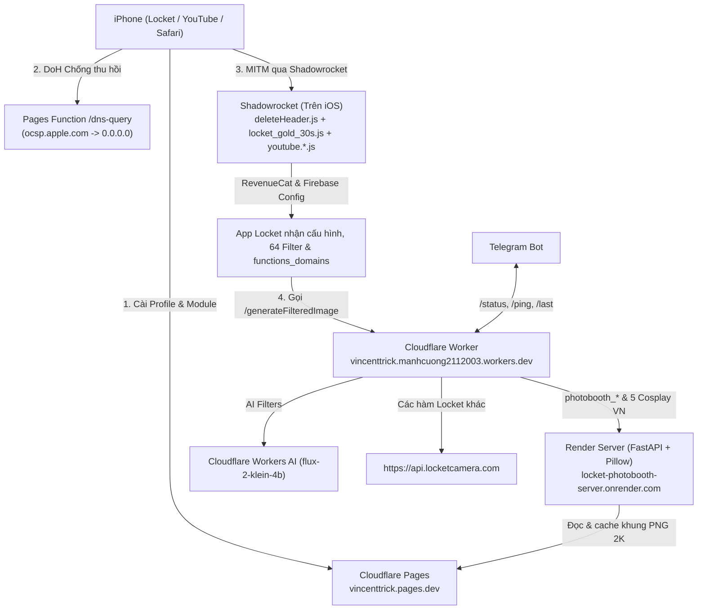

# Vincenttrick (`SDRK`) — Shadowrocket Portal, Photobooth 2K & AI Filter System

Hệ thống tích hợp **Portal cài đặt Shadowrocket + Anti-Revoke DNS**, **Module mở rộng Locket (Gold VIP, Video 30s, 62 Khung Photobooth 2K & Bộ lọc AI/Cosplay)** và **YouTube Premium / AdBlock**, vận hành trên Cloudflare Pages, Cloudflare Workers và Render.

---

## 1. Kiến trúc & Các Domain chính

| Thành phần | Nền tảng | Domain / Endpoint | Mã nguồn |
| :--- | :--- | :--- | :--- |
| **Portal & Assets CDN** | Cloudflare Pages | `https://vincenttrick.pages.dev` | `index.html`, `*.module`, `*.js`, `assets/` |
| **DoH Sinkhole (Chống thu hồi)** | Cloudflare Pages Function | `https://vincenttrick.pages.dev/dns-query` | `functions/dns-query.js`, `Vincent-DNS.mobileconfig` |
| **AI Filter, Proxy & Bot** | Cloudflare Workers | `https://vincenttrick.manhcuong2112003.workers.dev` | `worker.js`, `wrangler.jsonc` |
| **Photobooth 2K & Color Server** | Render (Docker + FastAPI) | `https://locket-photobooth-server.onrender.com` | `photobooth-server/app.py`, `Dockerfile` |

### Luồng hoạt động tổng quan



---

## 2. Cấu trúc thư mục

- `index.html` — Trang Portal cài đặt Shadowrocket, Anti-Revoke DNS và 1-chạm thêm Module.
- `locket.module`, `combo.module`, `youtube.module` — Các file cấu hình Module cho Shadowrocket.
- `locket_gold_30s.js`, `deleteHeader.js` — Script xử lý RevenueCat & Firebase Remote Config cho Locket.
- `youtube.request.js`, `youtube.response.js` — Script chặn quảng cáo & mở khóa YouTube Premium.
- `worker.js`, `wrangler.jsonc` — Cloudflare Worker (Workers AI, Cosplay/Photobooth routing, Transparent Reverse Proxy, Telegram Bot, Dashboard, Cron `*/10 * * * *`).
- `functions/dns-query.js` — RFC 8484 DoH Sinkhole cho các tên miền kiểm tra thu hồi chứng chỉ Apple.
- `assets/photobooth/` — 62 mẫu khung/cosplay/bộ lọc màu `2048×2048`, icon `512×512` và `manifest.json`.
- `assets/widget_frames/` — 9 khung viền màu Pastel/Neon cho Widget.
- `photobooth-server/` — Repo con (`locket-photobooth-server`) chứa FastAPI server (`app.py`), `Dockerfile`, `requirements.txt` và script sinh tài nguyên (`generate_assets.py`).

---

## 3. Hướng dẫn Setup cho Người dùng (iPhone / iPad)

1. **Mở bằng Safari** truy cập `https://vincenttrick.pages.dev/`.
2. **Cài Shadowrocket & DNS chống thu hồi:**
   - Nếu dùng Server Enterprise (Server 2, 3, 4), cài `Vincent-DNS.mobileconfig` trước trong **Cài đặt → Đã tải về hồ sơ**, sau đó vào **Quản lý VPN & Thiết bị** để bấm **Tin cậy** chứng chỉ doanh nghiệp.
3. **Thêm Module vào Shadowrocket:**
   - Chuyển sang tab **Mô-đun Tiện ích VIP**, chọn `Combo 2-in-1` (hoặc `Locket Gold` / `YouTube`) rồi bấm **Mở Trực Tiếp Trong Shadowrocket**.
4. **Bật Giải mã HTTPS (Bắt buộc):**
   - Trong Shadowrocket → **Config → HTTPS Decryption**: Bật công tắc, tạo/cài đặt chứng chỉ CA.
   - Vào **Cài đặt iPhone → Cài đặt chung → Giới thiệu → Cài đặt tin cậy chứng chỉ** và **gạt xanh** tin cậy chứng chỉ Shadowrocket.
   - Đảm bảo **Global Routing** ở màn hình chính Shadowrocket đang để **`Config`**.
5. **Bật VPN** trên Shadowrocket, vuốt tắt hẳn app Locket/YouTube rồi mở lại để sử dụng.

> **Xử lý nhanh khi bị mất Gold/Filter:** Vào Shadowrocket → **Module → Update** để nhận bản script mới nhất, kiểm tra lại công tắc **Tin cậy chứng chỉ** trong Cài đặt iPhone, tắt/bật lại VPN rồi mở lại Locket.

---

## 4. Hướng dẫn Setup & Triển khai cho Admin / Developer

### A. Cloudflare Pages (`vincenttrick.pages.dev`)
1. Kết nối repository `manhcuong2112003/Vincenttrick` với **Cloudflare Pages** (không cần build command, thư mục gốc `/`).
2. Pages tự động phục vụ toàn bộ file tĩnh và kích hoạt endpoint `/dns-query` từ `functions/dns-query.js`.

### B. Cloudflare Workers (`vincenttrick.manhcuong2112003.workers.dev`)
1. Kết nối repository `manhcuong2112003/Vincenttrick` với **Cloudflare Workers Builds** (đọc cấu hình tự động từ `wrangler.jsonc`, đã bật sẵn binding `AI` và Cron `*/10 * * * *`).
2. Cài đặt các biến môi trường / Secrets trên Cloudflare Dashboard (**Workers & Pages → vincenttrick → Settings → Variables and Secrets**):
   - `PHOTOBOOTH_SERVER_URL`: URL server Render (mặc định `https://locket-photobooth-server.onrender.com`).
   - `PHOTOBOOTH_SECRET`: Khóa bí mật khớp giữa Worker và Render (tùy chọn nhưng khuyên dùng).
   - `TELEGRAM_BOT_TOKEN` & `TELEGRAM_CHAT_ID`: Thông số Bot Telegram quản trị.
   - `DASHBOARD_PASS`: Mật khẩu truy cập `/dashboard`, `/api/ping`, `/setup-telegram`.
3. Kích hoạt Webhook Telegram (chạy 1 lần trên trình duyệt):
   ```
   https://vincenttrick.manhcuong2112003.workers.dev/setup-telegram?key=<DASHBOARD_PASS>
   ```
   Sau khi cài xong, Bot hỗ trợ các lệnh `/status`, `/ping`, `/last`.

### C. Render Photobooth 2K Server (`locket-photobooth-server`)
1. Tạo Web Service (Docker) trên **Render** kết nối với repo `manhcuong2112003/locket-photobooth-server`.
2. Cấu hình Environment Variables trên Render:
   - `PHOTOBOOTH_SECRET`: Trùng khớp với giá trị trên Cloudflare Worker.
   - `PHOTOBOOTH_ASSETS_URL`: `https://vincenttrick.pages.dev/assets/photobooth` (mặc định).
   - `PUBLIC_BASE_URL`: `https://locket-photobooth-server.onrender.com`.

### D. Quy trình cập nhật tài nguyên & Module
1. Sinh lại khung/icon mới (nếu có chỉnh sửa `photobooth-server/generate_assets.py`):
   ```powershell
   python photobooth-server/generate_assets.py
   ```
2. Kiểm tra cú pháp và 4 trụ cột trước khi push:
   ```powershell
   node --check worker.js
   node --check locket_gold_30s.js
   python -m py_compile photobooth-server/app.py
   ```
3. **Phá cache Shadowrocket:** Mỗi khi sửa `locket_gold_30s.js`, luôn tăng tham số `?v=YYYYMMDDx` ở dòng `script-path` trong **cả `locket.module` và `combo.module`**.
